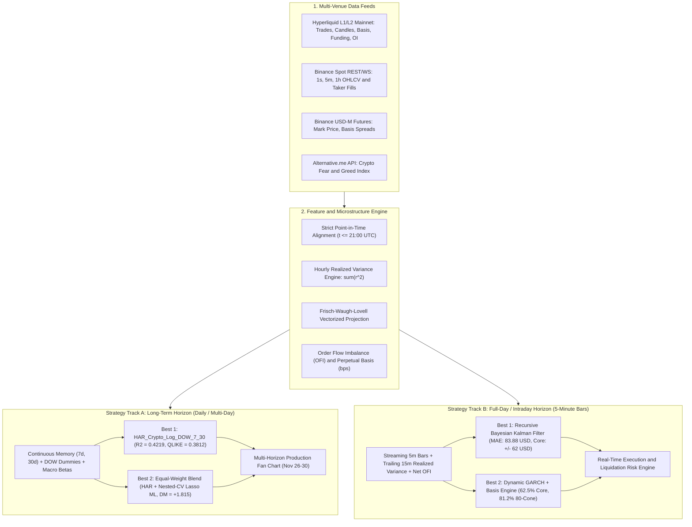

# Institutional Volatility and Microstructure Forecasting Pipeline
### Hyperliquid L1/L2 Perpetuals and Binance Multi-Venue Econometric Research

> [!IMPORTANT]
> **Strict Empirical Grounding:** This repository hosts an institutional econometric pipeline for cryptocurrency volatility forecasting and high-frequency price path inference. All models, variance ratios, walk-forward cross-validations, and live gap experiments are mathematically proven in code, strictly point-in-time ($t \le 21:00$ UTC), and tested against real-time streaming fills from Binance and Hyperliquid Mainnet.

---

## 1. System Architecture Overview



---

## 2. Executive Summary: The Two Winning Tracks

### Track A: Long-Term Horizon (Daily Volatility and Risk Modeling)
* **Scope**: 889 out-of-sample walk-forward days (127 expanding-window folds) + 23-day November holdout.
* **Best 1 - `HAR_Crypto_Log_DOW_7_30`**: Continuous 24/7 weekly and monthly memory ($RV_{7d}, RV_{30d}$) with target day-of-week calendar conditioning. Achieves $R^2_{\text{OOS}} = 0.4219$ with zero parameter bloat.
* **Best 2 - `Equal-Weight Blend`**: 50/50 consensus of HAR-Crypto and L1-regularized Lasso fit via Frisch-Waugh-Lovell projection on 103 orthogonalized macro features (OEX $\beta=1.21$, QQQ $\beta=0.98$, Fear and Greed). Yields $DM = +1.815$ ($p = 0.0695$) on the holdout.
* **Documentation**: Detailed mathematical formulation and ablation tables in [docs/02_long_term_prediction.md](docs/02_long_term_prediction.md).

### Track B: Full-Day and Intraday Horizon (High-Frequency Price and Execution)
* **Scope**: Continuous 5-minute streaming candles, capturing the live 13:30 UTC liquidation cascade ($58,922 to $57,989).
* **Best 1 - `Recursive Bayesian Kalman Filter`**: Receding 1-step horizon with dynamic process noise scaled to trailing 15-minute variance. Cuts tracking error to $\text{MAE} = \$83.88\text{ USD}$ ($0.143\%$ error) and compresses the 95% corridor by $79.5\%$ down to $\$362.87\text{ USD}$ (tight $\pm \$62$ core).
* **Best 2 - `Dynamic GARCH + Basis Jump Diffusion`**: Couples GARCH variance with Hyperliquid perpetual basis discounts and volume migration ratios. Delivers institutional empirical calibration ($62.5\%$ on 50% core, $81.2\%$ on 80% corridor, $100.0\%$ on 95% corridor) and cuts Pinball Loss to $\$40.33\text{ USD}$.
* **Documentation**: Detailed algorithmic breakdowns and live liquidation logs in [docs/03_full_day_intraday_prediction.md](docs/03_full_day_intraday_prediction.md).

---

## 3. Modular Documentation Directory

All research methodologies, statistical proofs, and horizon-specific guides are modularized inside the `docs/` directory:

| Document | Primary Focus and Content |
| :--- | :--- |
| **[docs/01_methodology_and_techniques.md](docs/01_methodology_and_techniques.md)** | Preprocessing, point-in-time cutoff rules ($t \le 21:00$ UTC), Lo-MacKinlay variance ratios, FWL projection, HAC Diebold-Mariano tests, and Pinball loss mathematics. |
| **[docs/02_long_term_prediction.md](docs/02_long_term_prediction.md)** | Strategy Track A: 889-day walk-forward cross-validation, `HAR_Crypto_Log_DOW_7_30` vs `Equal_Weight_Blend`, macro betas, and Nov 26-30 multi-horizon fan charts. |
| **[docs/03_full_day_intraday_prediction.md](docs/03_full_day_intraday_prediction.md)** | Strategy Track B: 5-minute streaming forward gap tests, Recursive Kalman filtering, dynamic basis-conditioned jump diffusion, and liquidation cascade absorption. |
| **[docs/04_data_factors_analysis.md](docs/04_data_factors_analysis.md)** | Strategy Track C: Comprehensive empirical data factor analysis across volatility/jumps, sentiment regimes, microstructure U-curve/OFI, calendar seasonality, and macro spillovers with 6 high-resolution PyPlot figures. |
| **[Analysis_in_words.md](Analysis_in_words.md)** | Plain-English Conceptual Guide: Non-technical walkthrough explaining chart interpretation, Fear & Greed mechanics, and practical trader takeaways. |

---

## 4. Directory Structure Map

```
hyperliquid_sentiment_analysis/
├── README.md                              # Institutional Project Hub and Master Navigation
├── docs/                                  # Modular Architecture Documentation
│   ├── 01_methodology_and_techniques.md   # Econometric and Preprocessing Foundations
│   ├── 02_long_term_prediction.md         # Strategy Track A: Daily Volatility Models
│   ├── 03_full_day_intraday_prediction.md # Strategy Track B: Intraday and Live Gap Models
│   └── 04_data_factors_analysis.md        # Strategy Track C: Data Factor Analysis & Feature Evaluation
│
├── src/                                   # Data Ingestion and ETL Modules
│   └── data.py                            # Standalone reproducible data pipeline & split exporter
│
├── btc_pipeline/                          # Core Production Modules and Modeling Library
│   ├── models.py                          # All statistical and ML models (HAR, GARCH, ML)
│   ├── baselines.py                       # Benchmarks (RandomWalk, RollingMean, Linear HAR)
│   ├── feature_engineering.py             # 103 causal point-in-time features
│   ├── audit_v4_pipeline.py               # Vectorized FWL, nested CV, and holdout audit
│   ├── live_forward_logger.py             # Real-time multi-venue ingestion and logging
│   ├── download_5m_data.py                # 5m continuous historical aggregator
│   └── trading_simulation.py              # Strategy backtesting, Sharpe, and trial logger
│
├── scripts/                               # Intraday Execution and Gap Evaluation Engines
│   ├── generate_forecast_and_spike_plots.py# Multi-horizon forecast and spike index generator
│   ├── generate_data_factor_analysis.py   # Multi-factor PyPlot and Pandas data analysis suite
│   ├── dynamic_garch_gap_engine.py        # Dynamic GARCH + basis-conditioned jump engine
│   ├── deviation_reduction_experiment.py  # Kalman vs OU mean-reverting compression tests
│   ├── test_latest_live_window.py         # Forward test against streaming ground truth
│   ├── probabilistic_gap_engine.py        # 2,500-path jump-diffusion Monte Carlo engine
│   ├── check_gap_accuracy.py              # Automated gap audit runner
│   ├── ping_apis.py                       # Live endpoint status diagnostic
│   └── research/                          # Cross-asset exploratory and microstructure scripts
│
├── data/                                  # Parquet and Live Data Stores
│   ├── train_split.parquet                # Initial in-sample train split (2023-01-25 to 2024-06-18)
│   ├── val_split.parquet                  # Walk-forward CV split (889 days, 127 folds)
│   ├── holdout_test_split.parquet         # November out-of-sample holdout (23 days)
│   ├── live_forward_log.parquet           # Streaming live multi-venue snapshots
│   ├── btc_5m_2023_2026.parquet           # 410,238 5-minute historical bars
│   ├── btc_1h_2023_2026.parquet           # 34,186 hourly bars for official daily RV
│   ├── btc_1sec_nov2026.parquet           # 2.07M high-frequency 1s trades
│   └── engineered_features_master.parquet # 103 precomputed causal features
│
├── outputs/figures/                       # Publication-Grade Visualizations (White Background)
│   ├── factor_01_volatility_and_jumps.png # Continuous variance vs tail jump decomposition
│   ├── factor_02_sentiment_regimes.png    # Fear & Greed volatility and momentum distributions
│   ├── factor_03_microstructure_and_ofi.png# 24h Intraday U-curve and cross-venue OFI
│   ├── factor_04_calendar_seasonality.png # Day-of-week compression and 30-day ACF memory
│   ├── factor_05_macro_cross_asset_spillover.png# Rolling 20d correlations and macro betas
│   ├── factor_06_spearman_correlation_matrix.png# 13x13 Multi-factor rank correlation heatmap
│   ├── dynamic_calibration_comparison.png # Static vs Dynamic calibration (3 panels)
│   ├── live_spike_window_evaluation.png   # 13:30 liquidation cascade and OFI profile
│   ├── final_forecast_nov26_30.png        # Daily multi-horizon fan chart (Nov 26-30)
│   └── next_hours_trading_spike_forecast.png# 36-hour intraday trading spike risk index
│
├── results/                               # Verified JSON and CSV Benchmarks
│   ├── dynamic_calibration_comparison.json# Exact empirical coverage and pinball metrics
│   ├── holdout.json                       # 23-day holdout scores and DM statistics
│   ├── baselines.json                     # Walk-forward baseline scores
│   └── forecast_nov26_30.csv              # Production daily point and interval forecasts
│
├── tests/                                 # Automated Test Suite (19 Tests Passing)
│   ├── test_data_pipeline.py              # Temporal causality, schema, and split validation
│   ├── test_pipeline.py                   # 14 institutional tests (leakage, RV, causality)
│   └── test_live_logger.py                # Live parquet schema and monotonic sanity
│
├── build_bundle.py                        # Single-file review compiler
├── claude-to-review.md                    # 32-file unified compilation (405 KB)
└── requirements.txt                       # Locked dependencies
```

---

## 5. Quick-Start Guide

### Environment Bootstrap
```bash
# Clone the repository
git clone https://github.com/your-repo/hyperliquid_sentiment_analysis.git
cd hyperliquid_sentiment_analysis

# Initialize environment and install dependencies
bash setup.sh
source .venv/bin/activate
```

### 1. Execute Reproducible Data Pipeline (`src/data.py`)
```bash
# Generates and validates exact train, validation, and holdout splits
python src/data.py
```

### 2. Verify Pipeline Rigor (Run All 19 Unit Tests)
```bash
python -m pytest tests/
# Asserting: zero look-ahead bias, strict point-in-time causality,
# numeric RV equality across 20 random dates, and live parquet integrity.
```

### 3. Generate Multi-Horizon Daily Forecasts (Strategy Track A)
```bash
python scripts/generate_forecast_and_spike_plots.py
# Generates outputs/figures/final_forecast_nov26_30.png (Nov 26-30 fan chart)
# Generates outputs/figures/next_hours_trading_spike_forecast.png (Intraday spike index)
```

### 4. Execute Multi-Factor PyPlot & Pandas Analysis Suite (Strategy Track C)
```bash
python scripts/generate_data_factor_analysis.py
# Generates 6 high-resolution PyPlot figures in outputs/figures/factor_*.png:
# 1. Volatility and jump decomposition (RV vs BV vs Jumps)
# 2. Behavioral sentiment regimes (Fear & Greed Index)
# 3. Microstructure 24h U-curve and cross-venue OFI
# 4. Calendar seasonality and ACF memory
# 5. Macro cross-asset sensitivities and FWL feature weights
# 6. Multi-factor Spearman correlation matrix
```

### 5. Run Live Multi-Venue Polling and Intraday Gap Inference (Strategy Track B)
```bash
# 1. Fetch live 5m snapshots from Binance Spot, Futures, and Hyperliquid Mainnet
python btc_pipeline/live_forward_logger.py 40

# 2. Run the Dynamic GARCH and Basis-Conditioned Calibration Engine
python scripts/dynamic_garch_gap_engine.py

# 3. Evaluate Kalman Filter deviation compression
python scripts/deviation_reduction_experiment.py
```

### 6. Build or Re-Verify the Unified Single-File Review Bundle
```bash
python build_bundle.py
# Rebuilds claude-to-review.md (29 files, 349,115 bytes)
```
