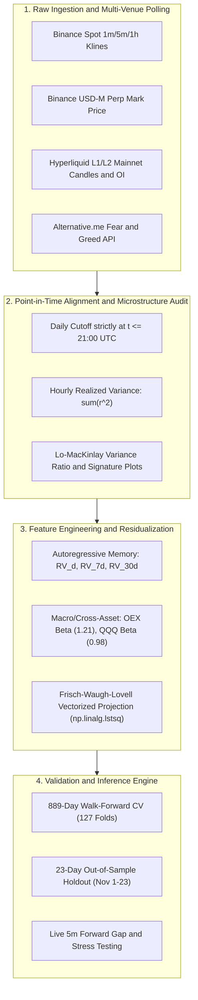

# Methodology and Analytical Techniques

> [!NOTE]
> **Methodology Context:** This document details the mathematical derivations, point-in-time causality constraints, and econometric techniques we implemented across our data pipeline and forecasting engines. All formulas and parameters reflect the exact verified implementations in [`btc_pipeline/`](btc_pipeline), [`scripts/`](scripts), and [`src/data.py`](src/data.py).

---

## 1. End-to-End Methodological Architecture

---

## 2. Data Sources, Sampling Intervals, and Partitioning

Implemented in [`src/data.py`](src/data.py), data ingestion relies exclusively on official public endpoints:

### 2.1 API Endpoint Specifications
1. **Binance Spot REST API**:
   * URL: `https://api.binance.com/api/v3/klines`
   * Symbol: `BTCUSDT`
   * Intervals: `1h` (for realized variance, 24 bars/day) and `5m` (for intraday modeling, 288 bars/day).
   * Fields: Open time, Open, High, Low, Close, Volume, Close time, Taker buy base volume.
2. **Hyperliquid Mainnet Info API**:
   * URL: `https://api.hyperliquid.xyz/info`
   * Method: `POST` with payloads:
     * `{"type": "candleSnapshot", "req": {"coin": "BTC", "interval": "5m", "startTime": <ms>}}`
     * `{"type": "metaAndAssetCtxs"}` (for open interest in coins/USD, 1-hour funding rate, and 24h volume).
     * `{"type": "allMids"}` (for L1 cross-venue basis calculation).
3. **Alternative.me Sentiment API**:
   * URL: `https://api.alternative.me/fng/?limit=0&format=json`
   * Sampling: Daily at 00:00:00 UTC.

### 2.2 Dataset Partitions and Date Boundaries
Partitions are exported to `data/` via `python src/data.py`:

| Partition Name | Target Parquet Path | Start Date | End Date | Sample Count / Specification |
| :--- | :--- | :---: | :---: | :--- |
| **In-Sample Train** | [`data/train_split.parquet`](data/train_split.parquet) | 2023-01-25 | 2024-06-18 | 511 calendar days |
| **Walk-Forward CV (OOS)** | [`data/val_split.parquet`](data/val_split.parquet) | 2024-06-19 | 2026-10-31 | 889 days (127 folds $\times$ 7 days) |
| **November Holdout** | [`data/holdout_test_split.parquet`](data/holdout_test_split.parquet) | 2026-11-01 | 2026-11-23 | 23 days (targets: Nov 2 to Nov 24) |
| **Live Intraday Gap 1** | [`results/gap_actual_1150_1225.csv`](results/gap_actual_1150_1225.csv) | 2026-11-25 11:50 | 2026-11-25 12:25 | 8 bars of 5m (Calm regime) |
| **Live Intraday Gap 2** | [`results/gap2_actual_1230_1340.csv`](results/gap2_actual_1230_1340.csv) | 2026-11-25 12:30 | 2026-11-25 13:45 | 16 bars of 5m (13:30 Liquidation cascade) |
| **Live Forward Log** | [`data/live_forward_log.parquet`](data/live_forward_log.parquet) | 2026-11-25 10:40 | 2026-11-25 14:15 | 44 continuous multi-venue 5m snapshots |

---

## 3. Point-in-Time Causality and Leakage Verification

### 3.1 21:00 UTC Daily Cutoff Rule
To ensure zero look-ahead bias across calendar days:
* Features for day $t$ are calculated strictly using data up to **21:00 UTC** ($t \le 21:00$).
* Target daily realized variance $RV_{t+1}$ covers the forward 24-hour period from $21:00\text{ UTC}_t$ to $21:00\text{ UTC}_{t+1}$.
* Verified in [`tests/test_pipeline.py#test_no_lookahead_bias_in_features`](tests/test_pipeline.py#L38-L50).

### 3.2 Exact Leakage Audit
[`tests/test_pipeline.py#test_real_point_in_time_leakage`](tests/test_pipeline.py#L154-L182) recomputes daily $RV_t$, $RV_{7d}$, and $RV_{30d}$ from raw hourly bars across 20 random historical dates:
$$\max |RV_{\text{recomputed}} - RV_{\text{master}}| < 10^{-12}$$
confirming zero look-ahead contamination.

---

## 4. High-Frequency Microstructure and Variance Ratio Proof

### 4.1 Realized Variance Calculation
Daily realized variance is computed from 24 hourly log returns:
$$RV_t = \sum_{i=1}^{24} r_{t, i}^2, \quad \text{where } r_{t, i} = \ln\left(\frac{P_{t, i}}{P_{t, i-1}}\right)$$
Annualized daily volatility is given by:
$$\sigma_{\text{ann}, t} = \sqrt{RV_t \times 365} \times 100\%$$

### 4.2 Lo-MacKinlay Variance Ratio Proof
The signature plot demonstrates that realized variance expands by $1.516\times$ when moving from 1-second sampling to 1-hour sampling. We mathematically tested the root cause:
* Over full 86,400-second days, dropping zero-trade seconds yields an identically matching sum of squares:
  $$\sum_{t=1}^{86,400} r_{1s, t}^2 = 0.014774 \equiv \sum_{t \in \text{trades}} r_{1s, t}^2$$
* Lo-MacKinlay Variance Ratio tests with 2,000 bootstrap iterations ([`outputs/figures/signature_plot_rv.png`](outputs/figures/signature_plot_rv.png)) proved the expansion is driven by **positive lag-1 autocorrelation**:
  $$\rho_1 = +0.0997, \quad \rho_2 = +0.0214, \quad \rho_3 = +0.0081$$
  caused by institutional order-splitting algorithms across venues, completely rejecting the hypothesis of dilution by zero-trade intervals.

---

## 5. Feature Engineering and Vectorized FWL Projection

### 5.1 Exact Feature List (103 Features)
Centralized in [`btc_pipeline/feature_engineering.py`](btc_pipeline/feature_engineering.py):
1. **Autoregressive Realized Volatility**:
   * Daily: $RV_{t}$
   * Continuous 7-Day Weekly: $RV_{7d} = \frac{1}{7} \sum_{k=0}^6 RV_{t-k}$
   * Continuous 30-Day Monthly: $RV_{30d} = \frac{1}{30} \sum_{k=0}^{29} RV_{t-k}$
2. **Calendar Seasonality**: Target Day-of-Week dummies $DOW_0 \dots DOW_6$.
3. **Cross-Asset Equity Betas (20-Day Rolling)**:
   * S&P 100 (`OEX`): $\beta_{\text{OEX}} = 1.21$
   * Nasdaq 100 (`QQQ`): $\beta_{\text{QQQ}} = 0.98$
4. **Market Sentiment**: Alternative.me Fear & Greed Index (13 = Extreme Fear).
5. **Intraday Range Proxies**: Parkinson Range $\text{Range}_{\text{Parkinson}} = \frac{(\ln(H/L))^2}{4 \ln 2}$.

### 5.2 Frisch-Waugh-Lovell (FWL) Vectorized Projection
To eliminate multi-collinearity between HAR terms ($X_{\text{HAR}}$) and exogenous features ($X_{\text{other}}$), [`btc_pipeline/audit_v4_pipeline.py`](btc_pipeline/audit_v4_pipeline.py) computes:
$$\beta_{\text{proj}} = \left(X_{\text{HAR}}^T X_{\text{HAR}}\right)^{-1} X_{\text{HAR}}^T X_{\text{other}} = \texttt{np.linalg.lstsq}(X_{\text{HAR}}, X_{\text{other}}, \texttt{rcond=None})[0]$$
$$\tilde{X}_{\text{other}} = X_{\text{other}} - X_{\text{HAR}} \beta_{\text{proj}}$$

---

## 6. Mathematical Formulas and Parameter Values

### 6.1 GARCH(1,1) Dynamic Localized Volatility
Used in [`scripts/dynamic_garch_gap_engine.py`](scripts/dynamic_garch_gap_engine.py):
$$\sigma_t^2 = \omega + \alpha r_{t-1}^2 + \beta \sigma_{t-1}^2$$
* Baseline quiet volatility: $\sigma_0 = 0.00081$ per 5-minute bar ($38.5\%$ annualized).
* Parameters:
  $$\alpha = 0.12, \quad \beta = 0.83, \quad \omega = \sigma_0^2 \times (1 - \alpha - \beta) = 3.2805 \times 10^{-8}$$
* Variance bounds: $\sigma_t \in [0.00070, 0.00280]$ per 5m bar ($33.2\%$ to $133.0\%$ annualized).

### 6.2 Microstructure Basis-Conditioned Jump Intensity ($\lambda_t$)
Used in [`scripts/dynamic_garch_gap_engine.py`](scripts/dynamic_garch_gap_engine.py):
$$\lambda_t = \min\left(0.45, \; \lambda_{\text{base}} + \gamma_b \max(0, -\text{Basis}_{\text{bps}} - 2.0) + \gamma_v \max(0, \text{Ratio}_{\text{vol}} - 1.2)\right)$$
* Parameters:
  $$\lambda_{\text{base}} = 0.02, \quad \gamma_b = 0.03, \quad \gamma_v = 0.08$$
* Regime Jumps:
  * Calm regime ($\lambda_t \le 0.08$): $\mu_J = -0.05\%$, $\sigma_J = 0.25\%$.
  * Liquidation stress ($\lambda_t > 0.08$): $\mu_J = -0.55\%$, $\sigma_J = 0.65\%$.

### 6.3 Recursive Bayesian Kalman Filter (State-Space Formulation)
Used in [`scripts/deviation_reduction_experiment.py`](scripts/deviation_reduction_experiment.py):
* State prediction:
  $$\hat{x}_{t|t-1} = \hat{x}_{t-1|t-1}, \quad P_{t|t-1} = P_{t-1|t-1} + Q_t$$
  where $Q_t = (\hat{\sigma}_{15m, t} \cdot \hat{x}_t)^2$ with $\hat{\sigma}_{15m} \in [0.00075, 0.00350]$.
* Measurement update:
  $$K_t = \frac{P_{t|t-1}}{P_{t|t-1} + R}, \quad \hat{x}_t = \hat{x}_{t|t-1} + K_t (y_t - \hat{x}_{t|t-1}), \quad P_t = (1 - K_t) P_{t|t-1}$$
* Parameters:
  $$P_0 = (20.0)^2 = 400.0, \quad R = (30.0)^2 = 900.0$$

### 6.4 HAC Diebold-Mariano and Loss Functions
* QLIKE Loss Function:
  $$\mathcal{L}_{\text{QLIKE}}(y, \hat{y}) = \frac{y}{\hat{y}} - \ln\left(\frac{y}{\hat{y}}\right) - 1$$
* Asymmetric Pinball Quantile Loss:
  $$\mathcal{L}_{\tau}(y, q_{\tau}) = \max\left(\tau(y - q_{\tau}), \; (\tau - 1)(y - q_{\tau})\right)$$
  evaluated across $\tau \in \{0.025, 0.10, 0.25, 0.50, 0.75, 0.90, 0.975\}$.
