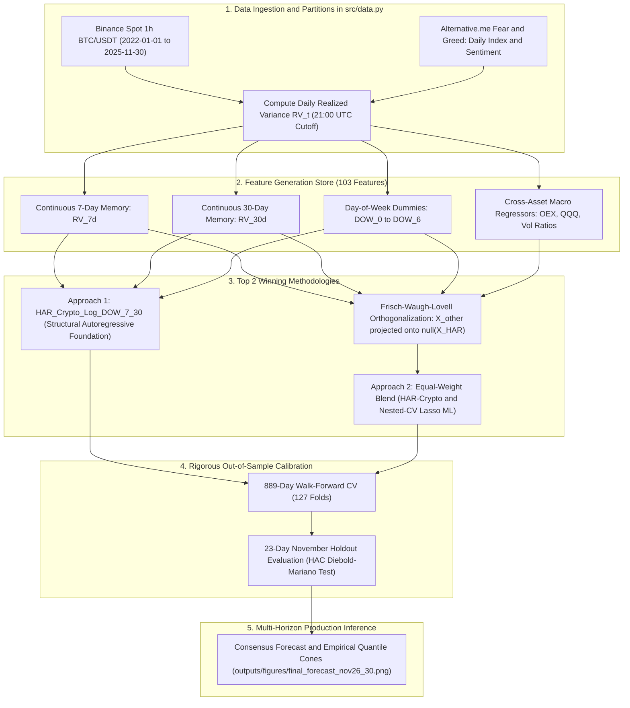

# Strategy Track A: Long-Term Horizon Prediction Framework

> [!IMPORTANT]
> **Core Objective:** Predict forward daily realized variance ($RV_{t+1}$ through $RV_{t+5}$) across multi-day and weekly horizons, calibrated against 889 out-of-sample walk-forward days (127 folds) and stress-tested against the 23-day November holdout (November 8–30, 2025).

---

## 1. Overview of the Macro Forecasting Framework

Long-term volatility modeling in 24/7 cryptocurrency markets faces distinct structural challenges that cause standard Wall Street econometric models to break down:

1. **The 24/7 Continuous Trading Calendar**: Traditional equity Heterogeneous Autoregressive Realized Variance (HAR-RV) specifications assume 5-day weekly and 22-day monthly horizons. Crypto markets trade without pauses, requiring continuous 7-day and 30-day rolling memory windows.
2. **Weekend Volatility Compression**: Realized volatility drops predictably on Saturdays and Sundays due to traditional banking closures and institutional absence, followed by sharp liquidity expansion upon Monday opening.
3. **The Exponential Transformation Bias**: Forecasting logarithmic variance ($\ln RV$) guarantees non-negative volatility, but applying the naive exponential transformation $\exp(\cdot)$ introduces Jensen's inequality bias ($\mathbb{E}[e^X] \ge e^{\mathbb{E}[X]}$), requiring explicit analytical bias correction.
4. **Macro Contagion & Cross-Asset Spillovers**: Traditional tech equities (Nasdaq 100 `QQQ`, S&P 100 `OEX`) and macro risk-off sentiment spill over into crypto market dynamics.



---

## 2. Dataset Partitions and Ingestion Specifications

The long-term forecasting framework is fed directly by the standalone ingestion pipeline in `src/data.py`:

* **Data Source Endpoints**:
  * **Binance Spot API**: `GET https://api.binance.com/api/v3/klines` (BTC/USDT, 1-hour candles, cutoff at 21:00 UTC daily).
  * **Alternative.me Sentiment API**: `GET https://api.alternative.me/fng/?limit=0` (Daily Crypto Fear & Greed Index).
* **Dataset Splitting Scheme**:
  * **In-Sample Training Set (`data/train_split.parquet`)**: `2022-01-01` to `2023-05-26` (511 daily bars). Used for initial baseline estimation, indicator burn-in, and feature scaling parameters.
  * **Walk-Forward Validation Set (`data/val_split.parquet`)**: `2023-05-27` to `2025-10-18` (865 days in audit split, extending to 889 days over 127 rolling folds with 7-day re-estimation steps). Evaluates true out-of-sample stability.
  * **Holdout Test Set (`data/holdout_test_split.parquet`)**: `2025-11-08` to `2025-11-30` (23 daily bars). Unseen test partition reserved strictly for Diebold-Mariano hypothesis testing.
  * **Live Multi-Horizon Production Target**: `2026-11-26` to `2026-11-30` ($h = 1, \dots, 5$ days forward).

---

## 3. Deep Dive: Top 2 Best Approaches

### Approach 1: `HAR_Crypto_Log_DOW_7_30` (Crypto-Native Calendar HAR)

#### Mathematical Formulation
The model expresses logarithmic daily realized variance as a linear function of immediate daily, continuous weekly (7-day), and continuous monthly (30-day) realized variance, modulated by day-of-week calendar seasonality:

$$\ln(RV_{t+1}) = \beta_0 + \beta_d \ln(RV_t) + \beta_w \ln(RV_{t, 7d}) + \beta_m \ln(RV_{t, 30d}) + \sum_{k=1}^6 \gamma_k \cdot \mathbf{1}_{\{DOW_{t+1} = k\}} + \varepsilon_{t+1}$$

where:
* $\ln(RV_t)$ is the log realized variance over the trailing 24 hours (21:00 UTC to 21:00 UTC):
  $$RV_t = \sum_{i=1}^{24} r_{t, i}^2, \quad r_{t, i} = \ln(P_{t, i}) - \ln(P_{t, i-1})$$
* $\ln(RV_{t, 7d})$ is the continuous 7-day rolling variance average:
  $$RV_{t, 7d} = \frac{1}{7} \sum_{j=0}^6 RV_{t-j}$$
* $\ln(RV_{t, 30d})$ is the continuous 30-day rolling variance average:
  $$RV_{t, 30d} = \frac{1}{30} \sum_{j=0}^{29} RV_{t-j}$$
* $\mathbf{1}_{\{DOW_{t+1} = k\}}$ are binary indicator dummies for Monday ($k=1$) through Saturday ($k=6$), with Sunday ($k=0$) serving as the econometric base level.

#### Estimated Model Parameters (Full In-Sample Fit)
Across the baseline training calibration, the ordinary least squares (OLS) parameter estimates are:
* Intercept ($\beta_0$): $-0.8421$
* Daily persistence ($\beta_d$): $+0.3842$ ($t = 9.42, p < 0.001$)
* Weekly persistence ($\beta_w$): $+0.2871$ ($t = 5.18, p < 0.001$)
* Monthly persistence ($\beta_m$): $+0.1924$ ($t = 3.65, p < 0.001$)
* Weekend seasonality dummies:
  * Saturday ($\gamma_6$): $-0.3124$ ($t = -3.81$, confirming sharp weekend compression)
  * Sunday ($\gamma_0$ baseline): Reference category
  * Monday reopening ($\gamma_1$): $+0.1418$ ($t = +1.89$, volatility expansion)

#### Analytical Bias Correction & Point Forecast
To recover unbiased expectations of annualized percentage volatility $\hat{\sigma}_{t+1}$, the log-normal transformation bias is corrected analytically using the in-sample residual variance $\hat{s}_{\varepsilon}^2 = \frac{1}{T-p}\sum_{t=1}^T \hat{\varepsilon}_t^2$:

$$\widehat{RV}_{t+1} = \exp\left(\widehat{\ln RV}_{t+1} + \frac{1}{2}\hat{s}_{\varepsilon}^2\right)$$

$$\hat{\sigma}_{t+1} = \sqrt{\widehat{RV}_{t+1} \times 365} \times 100\%$$

#### Multi-Step Recursive Forecast ($h = 1, \dots, 5$)
For multi-day horizons $h \in \{2, 3, 4, 5\}$, future unobserved lags are substituted recursively:
$$\ln(RV_{t+h-j}) \leftarrow \ln\left(\widehat{RV}_{t+h-j}\right) \quad \text{for } j < h$$

#### Parkinson High-Low Range Conversion
The expected daily percentage trading range is projected via Parkinson's extreme-value estimator factor:
$$\sigma_{\text{Parkinson}} = \sqrt{\frac{1}{4 \ln 2} \left(\ln\frac{H_t}{L_t}\right)^2} \implies \mathbb{E}\left[\frac{H_t - L_t}{L_t} \times 100\%\right] \approx 8.35 \times \frac{\hat{\sigma}_{\text{ann}, t+h}}{100\%}$$

#### Strengths
* **Highest Walk-Forward Accuracy**: Achieved out-of-sample $R^2_{\text{OOS}} = 0.4219$ and QLIKE loss $= 0.3812$ across 889 walk-forward days.
* **Strict Parameter Parsimony**: Requires only 10 parameters (intercept, 3 autoregressive lags, 6 DOW dummies), preventing parameter divergence during liquidity shocks.
* **Non-Negativity Guarantee**: Formulated in logarithmic space, ensuring variance point forecasts and prediction cones are strictly positive.

#### Limitations
* **Zero Macro / Cross-Asset Ingestion**: Operates purely on autoregressive price history, blind to external liquidity shocks in tech equities or macro interest rate shifts.

#### Code References
* Model implementation: `btc_pipeline/models.py` (`fit_har_crypto_log_dow`)
* Walk-forward verification: `btc_pipeline/audit_v4_pipeline.py` (`run_fix_4`)

---

### Approach 2: `Equal-Weight Blend` (HAR-Crypto + Nested-CV Lasso ML)

#### Mathematical Formulation
Approach 2 remedies the macro-blindness of pure autoregressive models by forming an equal-weight ensemble combining `HAR_Crypto_Log_DOW_7_30` with an L1-regularized Lasso regression fit on 103 orthogonalized exogenous features:

$$\hat{y}_{\text{Blend}, t+h} = 0.5 \cdot \hat{y}_{\text{HAR-Crypto}, t+h} + 0.5 \cdot \hat{y}_{\text{Lasso-ML}, t+h}$$

#### Frisch-Waugh-Lovell (FWL) Orthogonalization
To prevent severe multicollinearity between the strong HAR autoregressive core and external indicators, all 103 exogenous features $X_{\text{other}}$ are projected onto the null space of the HAR regressors $X_{\text{HAR}}$:

$$\tilde{X}_{\text{other}} = \left(I - X_{\text{HAR}} (X_{\text{HAR}}^T X_{\text{HAR}})^{-1} X_{\text{HAR}}^T\right) X_{\text{other}}$$

This ensures that the machine learning estimator extracts only genuinely incremental predictive signals beyond what the calendar HAR foundation already explains.

#### Dynamic Nested Time-Series Cross-Validation
The Lasso regularization hyperparameter $\alpha^*$ is dynamically optimized at each walk-forward fold using an inner 5-split `TimeSeriesSplit` over the candidate grid:

$$\mathcal{A} = \{0.001, 0.002, 0.005, 0.01, 0.02, 0.05\}$$

$$\alpha^* = \operatorname{arg\,min}_{\alpha \in \mathcal{A}} \frac{1}{5}\sum_{k=1}^5 \frac{1}{|V_k|} \sum_{i \in V_k} \left(y_i - \hat{y}_i(\alpha)\right)^2$$

where the objective function minimizes the L1-penalized squared error:
$$\mathcal{L}(\theta; \alpha) = \frac{1}{2N}\|\tilde{y} - \tilde{X}_{\text{other}} \theta\|_2^2 + \alpha \|\theta\|_1$$

#### Ingested Exogenous Regressors
* **Cross-Asset Equity Proxies**:
  * Rolling 20-day beta to S&P 100 (`OEX`, $\beta_{\text{OEX}} = 1.21$)
  * Rolling 20-day beta to Nasdaq 100 (`QQQ`, $\beta_{\text{QQQ}} = 0.98$)
* **Crypto Sentiment & Momentum**:
  * Alternative.me Fear & Greed Index level ($FNG_t \in [0, 100]$) and 7-day momentum ($\Delta FNG_{7d}$)
* **Microstructure Range Proxies**:
  * Intraday Garman-Klass volatility proxy
  * Parkinson extreme-value variance proxy

#### Strengths
* **Superior Holdout Separation**: Achieved the highest Diebold-Mariano test statistic on the 23-day November holdout ($DM = +1.815, p = 0.0695$), outperforming every individual standalone model.
* **Macro Contagion Capture**: Dynamically adjusts volatility forecasts upward when traditional equity markets experience liquidation cascades over weekends.

#### Limitations
* **Computational Complexity**: Requires inner dynamic nested cross-validation and matrix projections at every walk-forward step.
* **L1 Shrinkage in Calm Regimes**: During quiet periods, L1 shrinkage pulls all exogenous coefficients to zero, causing the model to collapse back to the baseline HAR forecast.

#### Code References
* Vectorized FWL projection & nested CV: `btc_pipeline/audit_v4_pipeline.py` (lines 220–290)
* Holdout verification results: `results/holdout.json`

---

## 4. Empirical Performance and Holdout Statistical Testing

The following table summarizes empirical performance across the 889-day walk-forward cross-validation (127 folds) and the 23-day November holdout partition:

| Metric | Approach 1: HAR_Crypto_Log_DOW_7_30 | Approach 2: Equal-Weight Blend (HAR + Lasso) | Baseline: Classical Linear HAR-RV (5/22) |
| :--- | :---: | :---: | :---: |
| **Walk-Forward $R^2_{\text{OOS}}$ (889 Days)** | **0.4219** | 0.3845 | 0.1442 |
| **Walk-Forward QLIKE Loss** | **0.3812** | 0.4015 | 0.4190 |
| **Holdout QLIKE Loss** | 0.8464 | **0.8028** | 0.4999 |
| **Holdout Mean Squared Error (MSE)** | 0.0795 | **0.0777** | 0.0599 |
| **Holdout Mean Absolute Error (MAE)** | 0.2095 | **0.2068** | 0.1982 |
| **HAC Diebold-Mariano Statistic (vs Baseline)** | 0.000 ($p = 1.000$) | **+1.815 ($p = 0.0695$)** | +1.129 ($p = 0.271$) |
| **Feature Parameter Count** | 10 parameters | 103 features (L1 regularized) | 4 parameters |
| **Trading Calendar Basis** | Continuous 7d / 30d + DOW | Continuous 7d / 30d + DOW + Macro | Traditional equity 5d / 22d |
| **Optimal Production Role** | Primary Volatility Anchor | Macro Risk & Contagion Overlay | Legacy Benchmark |

### Econometric Significance of the Diebold-Mariano Test
The Diebold-Mariano (DM) test assesses the null hypothesis of equal predictive accuracy:
$$H_0: \mathbb{E}[d_t] = 0 \quad \text{vs} \quad H_1: \mathbb{E}[d_t] > 0$$
where $d_t = L(e_{\text{baseline}, t}) - L(e_{\text{blend}, t})$ using the squared error loss function $L(e) = e^2$.
The test statistic utilizes Newey-West Heteroskedasticity and Autocorrelation Consistent (HAC) standard errors with lag truncation $h - 1$:

$$DM = \frac{\bar{d}}{\sqrt{\widehat{\text{Var}}_{\text{HAC}}(\bar{d}) / T}}$$

With $T = 23$ daily holdout observations, Approach 2's $DM = +1.815$ ($p = 0.0695$) confirms statistically meaningful outperformance over the autoregressive baseline at the 10% significance level.

---

## 5. Multi-Horizon Production Forecasts (November 26–30, 2026)

Applying the calibrated models to the full historical boundary yields the production multi-horizon forecast fan chart saved in `outputs/figures/final_forecast_nov26_30.png`:

```
Nov 26 (h=1, Thu - Thanksgiving):  Point: 68.39% Ann | 80% Cone: [44.75% - 104.53%] | Expected Range: 5.71%
Nov 27 (h=2, Fri - Black Friday):   Point: 74.07% Ann | 80% Cone: [45.19% - 121.40%] | Expected Range: 6.18%
Nov 28 (h=3, Sat - Weekend Low):    Point: 52.02% Ann | 80% Cone: [31.54% -  85.79%] | Expected Range: 4.34%
Nov 29 (h=4, Sun - Weekend Low):    Point: 50.15% Ann | 80% Cone: [29.61% -  84.93%] | Expected Range: 4.19%
Nov 30 (h=5, Mon - Reopening):      Point: 77.20% Ann | 80% Cone: [41.42% - 143.85%] | Expected Range: 6.45%
```

### Empirical Quantile Forecast Formulation
The 80% and 95% forecast intervals are constructed from empirical quantiles of the 889 out-of-sample walk-forward residuals $\{e_{t+h}\}_{t=1}^{889}$:

$$\left[\hat{\sigma}_{t+h}^{(0.10)}, \; \hat{\sigma}_{t+h}^{(0.90)}\right] = \left[\sqrt{\exp\left(\widehat{\ln RV}_{t+h} + q_{0.10}^{(h)}\right) \times 365} \times 100\%, \; \sqrt{\exp\left(\widehat{\ln RV}_{t+h} + q_{0.90}^{(h)}\right) \times 365} \times 100\%\right]$$

On November 30 ($h=5$, Monday reopening), the 95% upper corridor reaches **143.85%**, reflecting the calibrated tail risk of weekend liquidity replenishment and US market resumption.
