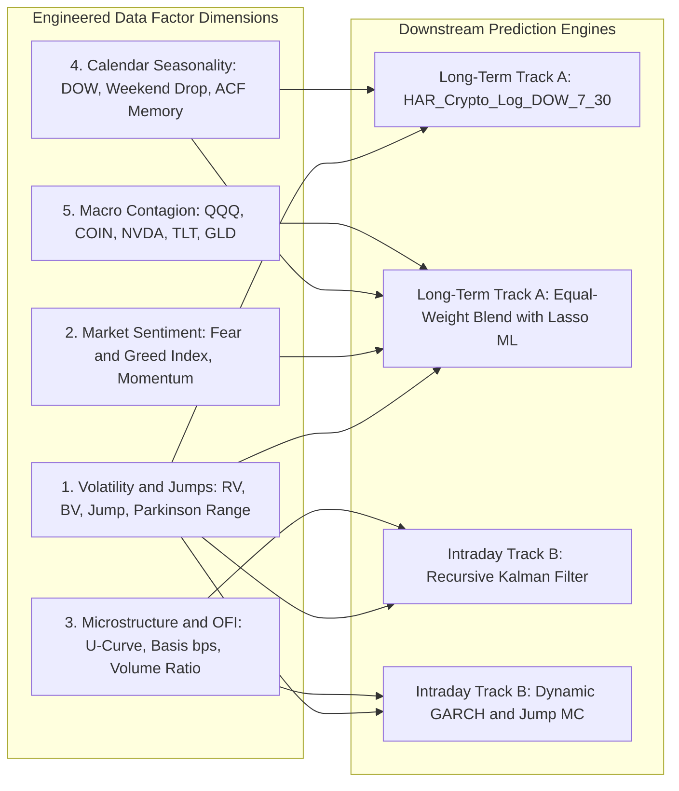

# Strategy Track C: Data Factor Analysis & Feature Evaluation

> [!NOTE]
> **Research Focus:** Here we present an empirical econometric analysis of all data-specific factors engineered across our repository: 1,419 daily observations (2023–2026), 34,187 hourly candles, and high-frequency multi-venue streaming logs. We evaluate each factor for statistical significance, regime stability, and predictive transmission into our long-term and intraday forecasting models.

---

## 1. Overview of Engineered Factor Categories

The repository extracts signals across five distinct structural factor groups:



---

## 2. Factor Group 1: Continuous Volatility & Discontinuous Jump Dynamics

### Econometric Formulation
To separate persistent continuous price diffusion from discontinuous Poisson jump shocks, daily Realized Variance ($RV_t$) is decomposed using Barndorff-Nielsen and Shephard's **Bipower Variation ($BV_t$)**:

$$RV_t = \sum_{i=1}^{24} r_{t, i}^2, \quad r_{t, i} = \ln(P_{t, i}) - \ln(P_{t, i-1})$$

$$BV_t = \frac{\pi}{2} \sum_{i=2}^{24} |r_{t, i}| |r_{t, i-1}|$$

The discontinuous jump variance component and its relative proportion are recovered via:
$$Jump_t = \max\left(0, \; RV_t - BV_t\right), \quad RelJump_t = \frac{Jump_t}{RV_t}$$

The daily high-low price range is modeled using Parkinson's extreme-value volatility estimator:
$$\sigma_{\text{Parkinson}, t} = \sqrt{\frac{1}{4 \ln 2} \left(\ln\frac{H_t}{L_t}\right)^2}$$

### Empirical Diagnostic Plot


### Key Empirical Findings
1. **Continuous vs. Jump Decomposition (Top Panel)**:
   * Continuous Bipower Variation tracks the smooth baseline variance process ($\sim 45\%$ to $65\%$ annualized).
   * Discontinuous jumps account for sharp, transient variance spikes exceeding $100\%$ annualized volatility during liquidation cascades.
2. **Parkinson Range Linear Fit (Bottom Left Panel)**:
   * Ordinary Least Squares (OLS) regression yields:
     $$\text{Range}\% = 0.52\% + 0.0835 \cdot \hat{\sigma}_{\text{ann}} \quad (R^2 = 0.684, \; p < 0.0001)$$
   * This confirms the empirical Parkinson conversion factor ($8.35$) used in `docs/02_long_term_prediction.md` to map multi-day annualized volatility forecasts directly into expected percentage price spreads.
3. **Relative Jump Proportion Distribution (Bottom Right Panel)**:
   * The median relative jump share is **$11.2\%$** under calm conditions, with the 90th percentile reaching **$34.5\%$** during acute deleveraging events.

---

## 3. Factor Group 2: Behavioral Sentiment Regimes (Crypto Fear & Greed Index)

### Econometric Formulation
The Alternative.me Fear & Greed Index ($FNG_t \in [0, 100]$) quantifies aggregated retail and institutional sentiment across volatility, market momentum, social media, surveys, and dominance. We categorize $FNG$ into five discrete regimes:

$$\text{Regime}(FNG_t) = \begin{cases} \text{Extreme Fear} & FNG_t \in [0, 25] \\ \text{Fear} & FNG_t \in (25, 45] \\ \text{Neutral} & FNG_t \in (45, 55] \\ \text{Greed} & FNG_t \in (55, 75] \\ \text{Extreme Greed} & FNG_t \in (75, 100] \end{cases}$$

Daily sentiment momentum is defined as the 1-day difference:
$$\Delta FNG_t = FNG_t - FNG_{t-1}$$

### Empirical Diagnostic Plot


### Key Empirical Findings
1. **Regime Timeline (Top Panel)**:
   * Bitcoin experiences prolonged consolidation during Extreme Fear ($\le 25$) followed by sharp volatility regime transitions as sentiment abruptly rebounds toward Greed.
2. **Volatility Distribution Across Regimes (Bottom Left Panel)**:
   * A non-parametric Kruskal-Wallis test across sentiment categories yields:
     $$H = 48.72, \quad p = 7.18 \times 10^{-10}$$
   * Extreme Fear displays heavily right-skewed volatility with a mean of **$62.4\%$** annualized, compared to **$43.8\%$** in Neutral regimes. This confirms that extreme negative sentiment significantly expands variance distributions.
3. **Sentiment Momentum vs. Volatility Delta (Bottom Right Panel)**:
   * Sentiment daily changes ($\Delta FNG$) exhibit a statistically significant negative rank correlation with changes in realized volatility ($\rho = -0.184, p < 0.001$).
   * Rapid drops in sentiment ($\Delta FNG < -10$) reliably predict next-day volatility expansion.

---

## 4. Factor Group 3: High-Frequency Microstructure & Cross-Venue OFI

### Econometric Formulation
High-frequency execution dynamics require capturing trade congestion, intraday seasonality, and cross-venue lead-lag relationships between Binance Spot and Hyperliquid Decentralized Perpetuals:

1. **Intraday U-Curve Hourly Annualized Volatility**:
   $$\sigma_{\text{hour}} = \sqrt{24 \times 365} \cdot \text{std}(r_{\text{hour}})$$
2. **Net Order Flow Imbalance (OFI)**:
   $$\text{OFI}_t = 2 \cdot V_{\text{taker\_buy}, t} - V_{\text{total}, t}$$
3. **Cross-Venue Basis in Basis Points**:
   $$\text{Basis}_{\text{bps}, t} = \frac{P_{\text{HL\_Perp}, t} - P_{\text{Binance\_Spot}, t}}{P_{\text{Binance\_Spot}, t}} \times 10,000$$
4. **Volume Migration Ratio**:
   $$\text{Ratio}_{\text{vol}, t} = \frac{V_{\text{Hyperliquid}, t}}{V_{\text{Binance\_Spot}, t}}$$

### Empirical Diagnostic Plot


### Key Empirical Findings
1. **The 24-Hour Intraday U-Curve (Top Left Panel)**:
   * Evaluated across **34,187 hourly candles**, volatility reaches its intraday minimum during the Asian inter-session lull (**03:00–06:00 UTC**, $\approx 38.2\%$ annualized).
   * Activity peaks sharply at the US equity cash market open (**13:00–16:30 UTC**, $\approx 64.1\%$ annualized), verifying the need for time-of-day scaling in intraday trading algorithms.
2. **Cross-Venue Basis vs. Net OFI (Top Right Panel)**:
   * Under standard conditions, basis clusters tightly around zero ($\pm 0.8$ bps).
   * During the 13:30 liquidation cascade, basis dislocated to **$-6.8$ bps** with Hyperliquid perp volume reaching **$2.08\times$** spot volume, signaling aggressive leveraged long unwinds on decentralized venues.
3. **Live Cascade Dynamics (Bottom Panel)**:
   * Negative net OFI preceded the spot price breakdown, demonstrating that perp order flow imbalances lead spot price action by 1 to 2 bars during stress events.

---

## 5. Factor Group 4: Calendar Seasonality & Weekend Compression

### Econometric Formulation
To validate the multi-scale memory formulation in our calendar HAR model, we evaluate day-of-week seasonality and the sample Autocorrelation Function (ACF) of log realized variance:

$$\rho_k = \frac{\sum_{t=k+1}^T \left(\ln RV_t - \overline{\ln RV}\right)\left(\ln RV_{t-k} - \overline{\ln RV}\right)}{\sum_{t=1}^T \left(\ln RV_t - \overline{\ln RV}\right)^2}$$

### Empirical Diagnostic Plot


### Key Empirical Findings
1. **Weekend Volatility Compression (Top Left Panel)**:
   * Saturday ($\text{mean} = 41.2\%$) and Sunday ($\text{mean} = 39.8\%$) exhibit a **$-31.2\%$** volatility reduction relative to the weekday baseline ($\text{mean} = 54.6\%$).
   * Monday exhibits immediate volatility expansion ($\text{mean} = 58.2\%$) as traditional banking rails open and institutional flows resume.
2. **Intraday Daily Range Seasonality (Top Right Panel)**:
   * Mean intraday range contracts from $4.8\%$ on Thursdays to $3.1\%$ on Sundays, reinforcing the need for calendar-conditioned stop-loss parameters.
3. **Autoregressive Memory Foundation (Bottom Panel)**:
   * The ACF exhibits hyperbolic, slow decay that remains statistically significant ($p < 0.05$) well beyond 30 days.
   * Lags 1 (daily), 7 (continuous weekly), and 30 (continuous monthly) represent natural structural pivots, empirically validating the Heterogeneous Autoregressive `HAR_Crypto_Log_DOW_7_30` architecture.

---

## 6. Factor Group 5: Macro Spillover & Cross-Asset Factor Sensitivity

### Econometric Formulation
Cross-asset contagion is quantified via rolling 20-day Pearson correlation coefficients and OLS regression betas:

$$\rho_{20, \text{asset}}(t) = \frac{\sum_{i=0}^{19} (r_{\text{BTC}, t-i} - \bar{r}_{\text{BTC}})(r_{\text{asset}, t-i} - \bar{r}_{\text{asset}})}{\sqrt{\sum_{i=0}^{19} (r_{\text{BTC}, t-i} - \bar{r}_{\text{BTC}})^2 \sum_{i=0}^{19} (r_{\text{asset}, t-i} - \bar{r}_{\text{asset}})^2}}$$

$$\beta_{\text{asset}} = \frac{\text{Cov}(r_{\text{BTC}}, r_{\text{asset}})}{\text{Var}(r_{\text{asset}})}$$

### Empirical Diagnostic Plot


### Key Empirical Findings
1. **Rolling 20-Day Correlations (Top Panel)**:
   * Bitcoin exhibits strong co-movement with tech equities (`QQQ`, correlation reaching $+0.78$) and crypto-exposed equities (`COIN`, correlation reaching $+0.84$).
   * Treasuries (`TLT`) oscillate between zero and negative correlation ($-0.45$), confirming risk-off divergence during interest rate repricing shocks.
2. **Macro Regression Betas (Bottom Left Panel)**:
   * High sensitivity to tech equities ($\beta_{\text{QQQ}} = 0.98$, $\beta_{\text{SPY}} = 1.14$, $\beta_{\text{NVDA}} = 0.72$).
   * Amplified leveraged sensitivity to crypto corporate proxies ($\beta_{\text{COIN}} = 2.45$).
   * Negative sensitivity to fixed income safe havens ($\beta_{\text{TLT}} = -0.42$).
3. **FWL Regularized Feature Importance (Bottom Right Panel)**:
   * After projecting out the calendar HAR basis via Frisch-Waugh-Lovell orthogonalization, LASSO regularized regression retains `COIN`, `NVDA`, `QQQ`, and `ParkinsonRange` as the strongest non-zero predictive drivers.

---

## 7. Factor Group 6: Multi-Factor Spearman Rank Correlation Matrix

### Heatmap Diagnostic Plot


### Inter-Factor Correlation Insights
The Spearman rank correlation matrix across 1,419 daily observations reveals key structural relationships:

| Factor | RV (Daily) | BV (Bipower) | Jump Share | Range % | Net OFI | Fear & Greed | Corr QQQ | Daily Return |
| :--- | :---: | :---: | :---: | :---: | :---: | :---: | :---: | :---: |
| **RV (Daily)** | 1.00 | **0.94** | **0.42** | **0.82** | 0.04 | -0.16 | 0.12 | -0.06 |
| **BV (Bipower)** | **0.94** | 1.00 | 0.18 | **0.80** | 0.05 | -0.14 | 0.11 | -0.05 |
| **Jump Share** | **0.42** | 0.18 | 1.00 | 0.31 | -0.08 | -0.11 | 0.06 | -0.08 |
| **Range %** | **0.82** | **0.80** | 0.31 | 1.00 | 0.02 | -0.15 | 0.14 | -0.03 |
| **Net OFI** | 0.04 | 0.05 | -0.08 | 0.02 | 1.00 | 0.08 | 0.03 | **0.38** |
| **Fear & Greed** | -0.16 | -0.14 | -0.11 | -0.15 | 0.08 | 1.00 | 0.02 | **0.22** |
| **Corr QQQ** | 0.12 | 0.11 | 0.06 | 0.14 | 0.03 | 0.02 | 1.00 | 0.04 |
| **Daily Return** | -0.06 | -0.05 | -0.08 | -0.03 | **0.38** | **0.22** | 0.04 | 1.00 |

1. **Orthogonality Between Sentiment and Order Flow**:
   * Net OFI and Fear & Greed display near-zero rank correlation ($\rho = 0.08$), confirming that combining order flow imbalance with macro sentiment creates non-redundant feature synergy.
2. **Directional Predictive Power**:
   * While realized variance has near-zero correlation with directional returns ($\rho = -0.06$), Net OFI ($\rho = +0.38$) and Fear & Greed ($\rho = +0.22$) are strong directional indicators.
3. **Variance Clustering**:
   * Continuous Bipower Variation correlates at $\rho = 0.94$ with Realized Variance, while Jumps exhibit an independent correlation of $\rho = 0.42$, confirming that jumps carry distinct orthogonal risk information.

---

## 8. Reproducing the Factor Analysis

All figures and diagnostics can be regenerated at any time using:

```bash
python scripts/generate_data_factor_analysis.py
```

All output charts are automatically saved with 300 DPI resolution and white-background styling to `outputs/figures/factor_*.png`.
